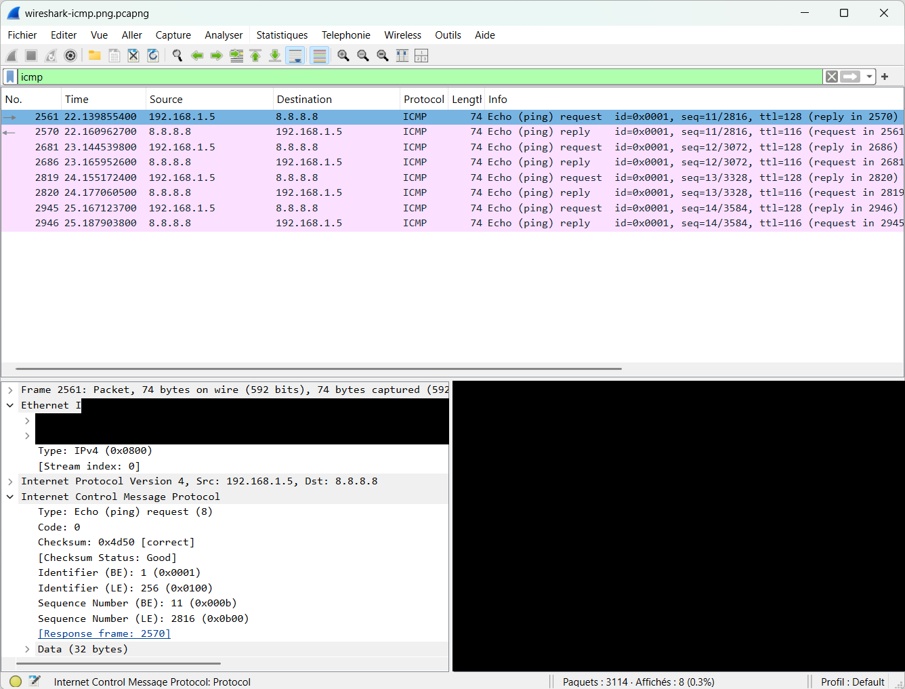
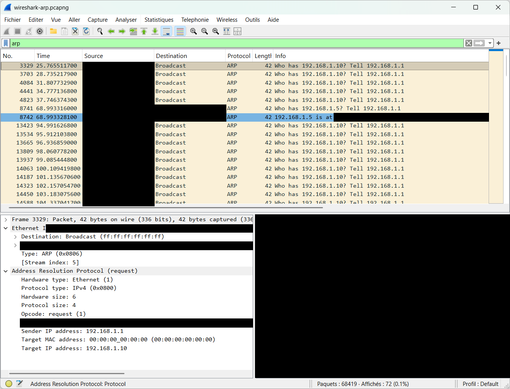
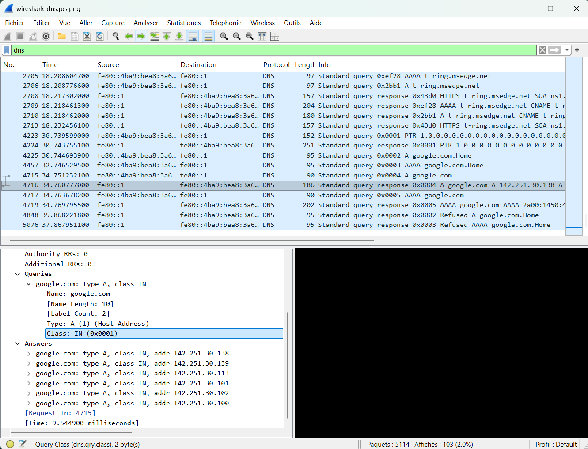
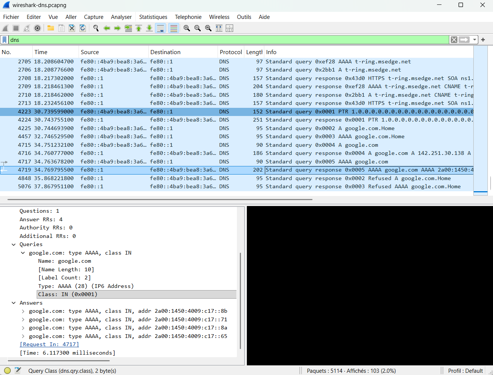
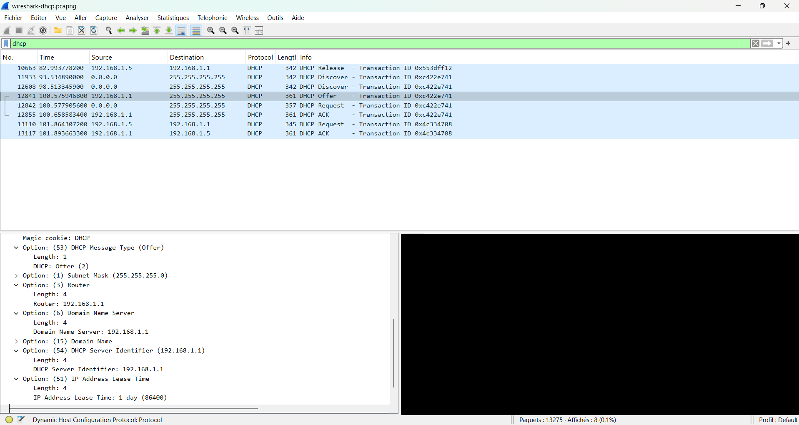
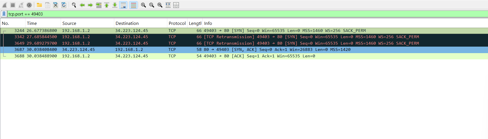
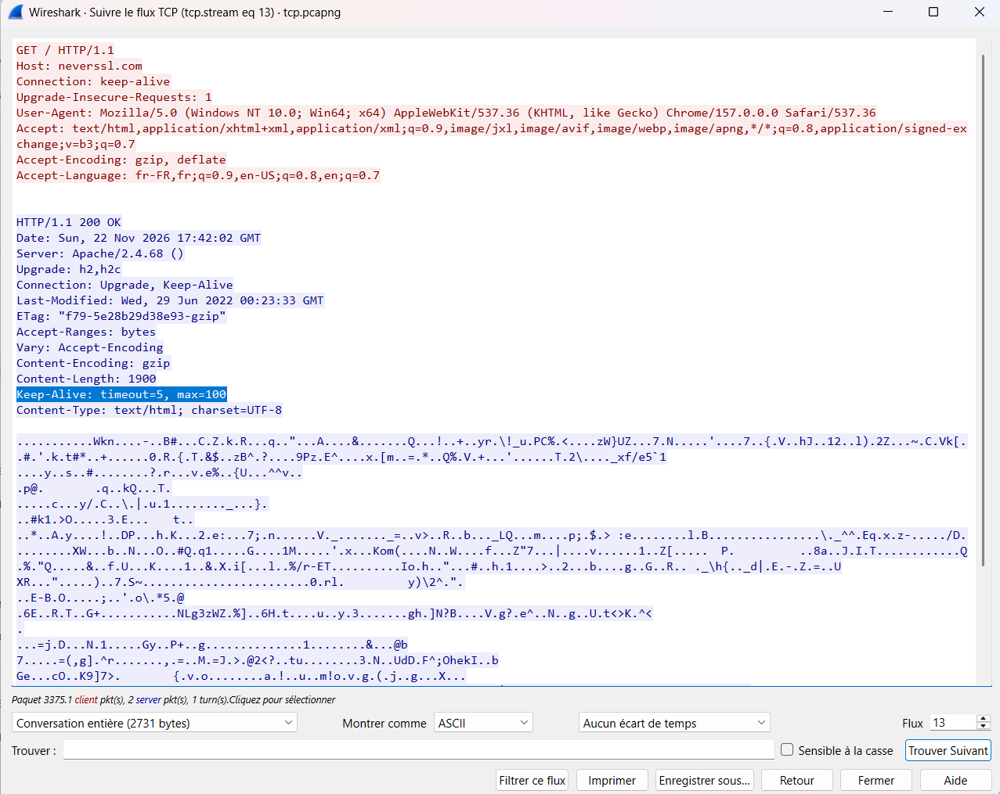
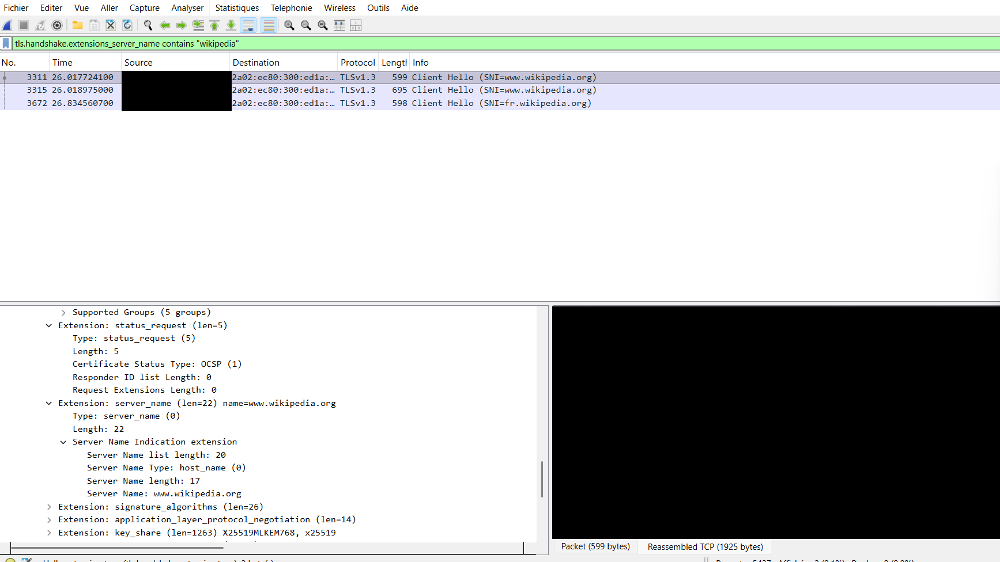

# Analyse de trafic réseau avec Wireshark : ICMP, ARP, DNS, DHCP

Captures et analyses de quatre protocoles fondamentaux sur mon réseau local, avec Wireshark : lecture des paquets couche par couche, filtres d'affichage, diagnostic.

- **Auteur** : Aka Elogane Chris-Eden
- **Date** : 16/11/2026
- **Outil** : Wireshark (Windows) avec Npcap
- **Complément du projet** : [reseau-entreprise-vlan](https://github.com/eloganechrisedenaka-lab/reseau-entreprise-vlan) (réseau d'entreprise sous Packet Tracer)

---

## 1. Objectif

Observer sur un réseau réel ce que j'ai configuré en simulation : comprendre ce qui circule quand un poste obtient une adresse, résout un nom et joint un serveur distant. Les adresses MAC sont partiellement masquées (`xx`) dans le texte, et masquées sur les captures d'écran. Les fichiers de capture bruts (`.pcapng`) ne sont pas publiés.

## 2. Environnement

| Élément | Valeur |
|---|---|
| Poste | PC Windows, `192.168.1.5/24` |
| Passerelle / box | `192.168.1.1` (également serveur DHCP et DNS) |
| Accès | Réseau domestique, une seule interface capturée |
| Limite | Sur un réseau commuté, je ne vois que mon trafic et le broadcast |

**Règle respectée :** captures réalisées uniquement sur mon propre réseau, courtes et ciblées.

## 3. Méthode

1. Démarrer la capture sur l'interface active.
2. Provoquer le trafic voulu (ping, `nslookup`, `ipconfig /release` puis `/renew`).
3. Arrêter la capture, appliquer un filtre d'affichage.
4. Déplier les couches du paquet et relever les champs utiles.

---

## 4. Analyse 1 : ICMP (ping)

**Commande :** `ping 8.8.8.8` | **Filtre :** `icmp`

| Champ | Valeur observée |
|---|---|
| Échanges | 4 Echo request (type 8) et 4 Echo reply (type 0) |
| Source → destination | `192.168.1.5` → `8.8.8.8` |
| MAC de destination de la requête | `bc:bd:84:xx:xx:xx`, soit la **box**, pas Google |
| TTL de la requête | 128 (valeur de départ Windows) |
| TTL de la réponse | 116 (environ 12 routeurs traversés) |
| Temps de réponse | 21,1 / 21,4 / 21,9 / 20,8 ms |

**Ce que j'en retiens :**
- Pour joindre une adresse hors du réseau local, le PC envoie la trame à sa **passerelle** : la MAC de destination est celle de la box, l'IP de destination reste celle du serveur final.
- L'adresse MAC change à chaque saut, l'adresse IP reste la même de bout en bout.
- Le TTL de la réponse permet d'estimer le nombre de sauts.

---

## 5. Analyse 2 : ARP

**Commandes :** `arp -d *` puis `ping 192.168.1.1` | **Filtre :** `arp`

| Champ | Valeur observée |
|---|---|
| Requête (opcode 1) | « Qui a `192.168.1.5` ? Répondre à `192.168.1.1` » |
| Réponse (opcode 2) | `192.168.1.5` est à `ec:2e:98:xx:xx:xx` |
| Particularité | C'est **la box qui a interrogé mon PC**, car son cache ARP avait expiré |
| Autre observation | Requêtes répétées de la box vers `192.168.1.10`, sans réponse (appareil absent) |

**Ce que j'en retiens :**
- L'ARP fonctionne dans les deux sens : n'importe quel équipement peut demander la MAC d'une IP du réseau local.
- L'ARP résout l'IP du **prochain saut**, pas forcément celle de la destination finale.
- En IPv6, ARP n'existe plus : il est remplacé par **NDP**, que j'ai aussi observé entre mon PC et `fe80::1`.

---

## 6. Analyse 3 : DNS

**Commande :** `nslookup google.com` | **Filtre :** `dns`

Séquence observée :

| Ordre | Requête | Résultat |
|---|---|---|
| 1 | PTR de l'adresse du serveur DNS (DNS inverse) | Noms de la box |
| 2 | `google.com.Home` (types A et AAAA) | **Refused** (rcode 5), après 5,1 secondes |
| 3 | `google.com` type **A** | 6 adresses IPv4, ex. `142.251.30.138`, en 9,5 ms |
| 4 | `google.com` type **AAAA** | 4 adresses IPv6, ex. `2a00:1450:4009:c17::8b`, en 6,1 ms |

| Champ | Valeur observée |
|---|---|
| Serveur DNS | La box : `192.168.1.1` en IPv4, `fe80::1` en IPv6 |
| Transport | UDP, port de destination 53 |

**Ce que j'en retiens :**
- **A** associe un nom à une adresse IPv4 (32 bits), **AAAA** à une adresse IPv6 (128 bits).
- Windows ajoute le **suffixe DNS** `.Home` reçu par DHCP : la première requête échoue avant que `google.com` soit résolu. Je l'ai relié à l'option « domaine » vue dans le DHCP.
- Codes de réponse : `0` succès, `3` nom inexistant, `5` refusé.
- Une capture de quelques minutes révèle beaucoup de requêtes DNS de fond (services Microsoft), même sans navigation.

---

## 7. Analyse 4 : DHCP (DORA)

**Commandes :** `ipconfig /release` puis `ipconfig /renew` | **Filtre :** `dhcp`

| Message | Source | Destination | Remarque |
|---|---|---|---|
| **Discover** | `0.0.0.0:68` | `255.255.255.255:67` | Broadcast (MAC `ff:ff:ff:ff:ff:ff`), renvoyé après 5 s |
| **Offer** | `192.168.1.1:67` | `255.255.255.255:68` | Propose `192.168.1.5` |
| **Request** | `0.0.0.0:68` | `255.255.255.255:67` | Demande l'adresse proposée |
| **Ack** | `192.168.1.1:67` | `255.255.255.255:68` | Confirme le bail |

| Paramètre reçu | Valeur |
|---|---|
| Adresse proposée (`yiaddr`) | `192.168.1.5` |
| Masque | `255.255.255.0` |
| Passerelle (router) | `192.168.1.1` |
| Serveur DNS | `192.168.1.1` |
| Domaine | `Home` |
| Durée du bail | 86 400 s (1 jour) |
| Serveur DHCP | `192.168.1.1` |

**Ce que j'en retiens :**
- Le Discover est envoyé en **broadcast** car le PC n'a pas d'IP et ne connaît pas le serveur ; il s'identifie avec `0.0.0.0`.
- L'Offer et l'Ack sont aussi envoyés en broadcast IP, car le PC n'a pas encore d'adresse.
- La box m'a redonné la même adresse, car elle me reconnaît par ma MAC.
- Après le DORA, un second échange Request/Ack en unicast confirme le bail.
- Diagnostic : pas de Discover = problème côté poste ; Discover sans Offer = problème côté serveur ou liaison (VLAN, relais DHCP).

---

## 8. Analyse 5 : TCP (poignée de main et retransmissions)

**Action :** ouverture de `http://neverssl.com` (site volontairement en HTTP) | **Filtres :** `tcp.flags.syn == 1`, `tcp.port == 59134`

| Champ | Valeur observée |
|---|---|
| Serveur | `34.223.124.45` (neverssl.com), port 80 |
| Connexions | Plusieurs connexions ouvertes en parallèle par le navigateur (une seule a transporté la page) |
| Poignée de main | SYN, SYN-ACK, ACK |
| Connexion de la page | SYN, retransmis 1 s plus tard, SYN-ACK reçu environ 281 ms après le dernier SYN |

**Un cas de retransmission observé (port source 49403) :**

| Temps | Événement |
|---|---|
| 26,68 s | 1er SYN, sans réponse |
| 27,69 s | 2e SYN (1 s plus tard), sans réponse |
| 29,69 s | 3e SYN (2 s plus tard) |
| 30,04 s | SYN-ACK reçu |

Délai total entre le premier SYN et le SYN-ACK : **3,36 s**, dont 3 s d'attente. Le vrai temps d'aller-retour, mesuré entre le dernier SYN et le SYN-ACK, est d'environ **349 ms**.

**Ce que j'en retiens :**
- TCP ouvre la connexion en 3 temps (SYN, SYN-ACK, ACK) avant tout échange de données.
- Un SYN sans réponse est renvoyé après 1 s, puis 2 s : le délai affiché dans l'interface (3,36 s) mélange l'attente et le vrai temps d'aller-retour.
- Des SYN perdus signalent une liaison qui perd des paquets ou qui est congestionnée. Un aller-retour de 280 à 350 ms est élevé et cohérent avec un serveur lointain.
- Un navigateur ouvre plusieurs connexions en parallèle pour aller plus vite.
- Filtres utiles : `tcp.flags.syn == 1`, `tcp.analysis.retransmission`, `tcp.analysis.flags`.

---

## 9. Analyse 6 : HTTP en clair

**Filtre :** `http`, puis **Suivre > Flux TCP** sur la requête `GET`

| Champ | Valeur observée |
|---|---|
| Requête | `GET / HTTP/1.1` |
| En-tête `Host` | `neverssl.com` |
| `User-Agent` | Navigateur et système lisibles en clair |
| Réponse | `HTTP/1.1 200 OK` |
| `Server` | Apache (logiciel du serveur annoncé) |
| `Content-Encoding` | `gzip` (corps compressé) |
| `Keep-Alive` | `timeout=5, max=100` |
| Fermeture | `FIN` envoyé par le serveur environ 5 s après la réponse |

**Ce que j'en retiens :**
- En HTTP, la requête et la réponse sont lisibles par n'importe qui sur le trajet : site visité, navigateur, système, langue.
- La compression `gzip` n'est pas du chiffrement : elle réduit la taille, mais ne protège rien.
- Le `FIN` tardif s'explique par `Keep-Alive: timeout=5` : le serveur garde la connexion ouverte 5 secondes d'inactivité, pour éviter de refaire une poignée de main (un aller-retour de plus), puis la ferme proprement.
- Annoncer son logiciel serveur (`Server: Apache`) donne une information utile à un attaquant : on la masque sur un serveur bien configuré.

---

## 10. Analyse 7 : HTTPS et TLS

**Action :** ouverture de `https://www.wikipedia.org` | **Filtres :** `tls.handshake.type == 1` (Client Hello), `tls.handshake.extensions_server_name contains "wikipedia"`

| Champ | Valeur observée |
|---|---|
| Port | 443 |
| Nom du site (SNI) dans le Client Hello | `www.wikipedia.org` (puis `fr.wikipedia.org`, `upload.wikimedia.org`) |
| Version dans la couche « Record » | TLS 1.0 (valeur de compatibilité historique) |
| Version dans le Client Hello | TLS 1.2 (champ hérité), avec TLS 1.3 et 1.2 proposés dans `supported_versions` |
| Version négociée (Server Hello) | **TLS 1.3** |
| Suites de chiffrement proposées | 16 |
| Suite choisie par le serveur | `TLS_AES_128_GCM_SHA256` |
| « Suivre le flux TCP » | Contenu illisible (chiffré) |

**Ce que j'en retiens :**
- La version réellement négociée se lit dans le **Server Hello** (extension `supported_versions`), pas dans la ligne « Record Layer ».
- Le contenu est chiffré après la poignée de main TLS : en « Suivre le flux », on ne voit que des octets illisibles, contrairement à HTTP.
- Le **nom du site reste visible** dans le Client Hello (SNI), car le serveur doit savoir quel site est demandé avant de chiffrer. TLS protège le contenu, pas le destinataire. L'extension ECH, qui vise à masquer ce nom, est présente mais le nom reste lisible dans cette capture.
- Ce qui reste visible en HTTPS : adresse IP du serveur, nom du site, taille et rythme des paquets.
- Vocabulaire : HTTP n'est pas « non sécurisé » mais **non chiffré**.

| | HTTP | HTTPS |
|---|---|---|
| Port | 80 | 443 |
| Requête et en-têtes | Lisibles | Chiffrés |
| Contenu de la page | Lisible | Chiffré |
| Visible malgré tout | Tout | IP, nom du site (SNI), tailles et rythme |

---

## 11. Synthèse

| Protocole | Couche | Rôle | Transport | Filtre |
|---|---|---|---|---|
| ARP | 2 | IP du prochain saut → adresse MAC | Directement sur Ethernet | `arp` |
| DHCP | 7 | Attribuer adresse, passerelle, DNS | UDP 67 / 68 | `dhcp` |
| DNS | 7 | Nom de domaine → adresse IP | UDP 53 | `dns` |
| ICMP | 3 | Test de joignabilité (ping) | Dans IP | `icmp` |
| TCP | 4 | Connexion fiable (SYN, SYN-ACK, ACK), retransmissions | IP | `tcp` |
| HTTP | 7 | Web en clair | TCP 80 | `http` |
| TLS (HTTPS) | 5 à 7 | Web chiffré | TCP 443 | `tls` |

Chaîne complète lors de l'ouverture d'un site : DHCP (j'obtiens mon adresse) → ARP (je trouve la MAC de ma passerelle) → DNS (je résous le nom) → TCP (j'ouvre la connexion) → TLS (je chiffre) → HTTP (j'échange la page).

## 12. Méthode de diagnostic retenue

1. **Le poste a-t-il une adresse ?** Filtre `dhcp` : Discover et Offer présents ?
2. **Trouve-t-il sa passerelle ?** Filtre `arp` : requête et réponse ?
3. **Résout-il les noms ?** Filtre `dns` : réponses avec `rcode 0` ?
4. **La destination répond-elle ?** Filtre `icmp` : request et reply ?
5. **La connexion s'ouvre-t-elle ?** Filtre `tcp.flags.syn == 1` : SYN-ACK reçu ? SYN retransmis (`tcp.analysis.retransmission`) = pertes ou lenteur.
6. **Le chiffrement s'établit-il ?** Filtre `tls.handshake` : Client Hello, Server Hello, version et suite négociées.

## 13. Compétences démontrées

Capture et sauvegarde de trafic, filtres d'affichage, lecture des couches Ethernet / IP / UDP, interprétation de DHCP, DNS, ARP, ICMP, TCP, HTTP et TLS, détection de retransmissions, corrélation entre plusieurs protocoles, méthode de diagnostic couche par couche.

## 14. Suite prévue

- Capture du trafic SSH entre le PC et une VM Linux (Ubuntu Server).
- Analyse de captures publiques d'incidents (exercices guidés).
- Diagnostic de pannes réseau simulées (DNS cassé, mauvaise passerelle, DHCP absent).
